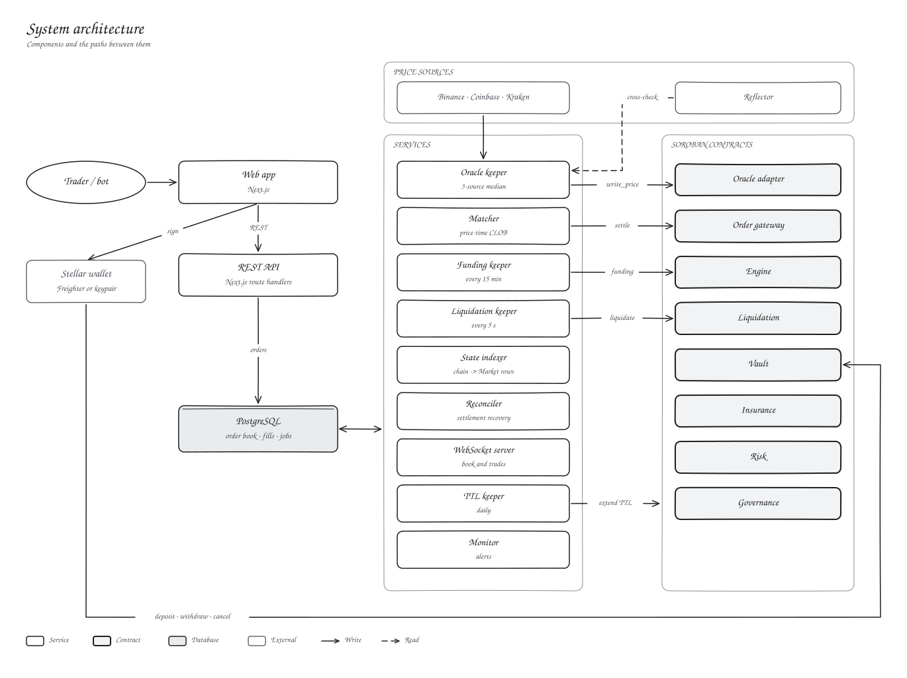

# Kryon Protocol · Architecture

The architecture documentation has moved into the documentation site so that it can be maintained alongside the contract, trading and operations references.

| Topic | Page |
| --- | --- |
| Components and data paths | [System architecture](docs/docs/02-architecture/system-architecture.md) |
| What the chain guarantees versus the operator | [On-chain and off-chain boundary](docs/docs/02-architecture/onchain-offchain-boundary.md) |
| Repository and module structure | [Component dependencies](docs/docs/02-architecture/component-dependencies.md) |
| Third-party systems | [External integrations](docs/docs/02-architecture/external-integrations.md) |
| Price ingestion and validation | [Oracle architecture](docs/docs/02-architecture/oracle-architecture.md) |
| The eight Soroban contracts | [Contract suite overview](docs/docs/03-smart-contracts/overview.md) |
| End-to-end trade | [Order lifecycle](docs/docs/04-trading-mechanics/order-lifecycle.md), [Settlement](docs/docs/04-trading-mechanics/settlement.md) |
| Off-chain services | [Backend services](docs/docs/05-infrastructure/backend-services.md) |
| Trust boundaries | [Threat model](docs/docs/08-security/threat-model.md) |

The previous version of this file, including its flow-by-flow walkthrough, remains in the Git history.
