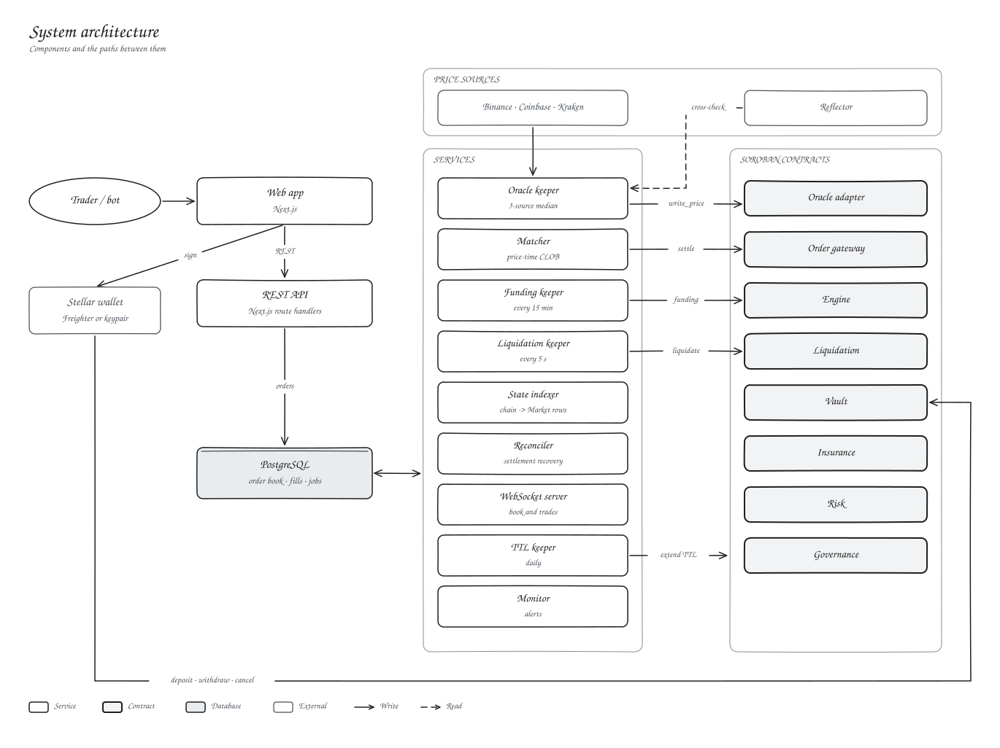

<div align="center">


# Kryon Protocol


**A decentralised perpetual-futures exchange on Stellar / Soroban.**

Off-chain CLOB matching with per-fill on-chain settlement, custody, margin checks and position accounting are enforced by Soroban contracts.

[Live App](https://kryonprotocol.vercel.app) · [Documentation](https://kryonprotocol.vercel.app/docs) · [Architecture](#architecture) · [Quick Start](#quick-start)


-orange)


</div>

---

## What is Kryon?

Kryon is a perpetual-futures DEX that pairs an **on-chain margin engine and settlement layer** (eight Soroban smart contracts) with an **off-chain central-limit order book matcher**, giving traders a familiar low-latency perp experience without giving up self-custody.

- **Launch market:** `XLM-PERP`, quoted and settled in **USDC** (BTC-PERP and ETH-PERP market configs are ready to enable)
- **Leverage:** up to 10× with 1000bps initial margin on the launch market
- **Custody:** collateral never leaves the on-chain vault; the matcher can only settle orders traders have signed
- **Network:** Stellar **testnet** (test funds only). A trial mainnet deployment ran from 2026-07-07 and was retired on 2026-11-11: see [Status](#status--roadmap)

Traders sign order intents with [Freighter](https://freighter.app), the matcher pairs them price-time priority, and every fill is settled on-chain through the order gateway into a single volume-weighted position per (trader, market).

## Architecture



The full architecture, with 33 editable Excalidraw diagrams, is in the [documentation](docs/docs/index.md).

### On-chain (Soroban contracts, Rust `#![no_std]`)

| Contract | Responsibility |
| --- | --- |
| `perp-vault` | SEP-41 collateral custody, internal balances, risk-gated withdrawals |
| `perp-engine` | Position lifecycle, execution price bands, OI caps, fees, funding indexes, realized PnL settlement |
| `perp-order-gateway` | Settlement entry point for matched fills, nonce tracking, overfill protection, self-trade rejection, cancellations |
| `perp-oracle-adapter` | Guarded price snapshots: publisher auth, staleness checks, quorum medianization, deviation bounds |
| `perp-liquidation` | Account-health liquidation executor with capped rewards and bad-debt recording |
| `perp-insurance` | Insurance fund custody, rewards, bad-debt accounting |
| `perp-risk` | Thin Soroban boundary around the pure Rust risk engine |
| `perp-governance` | Timelock proposal registry and guardian pause control |

The authorisation graph is strict: `Engine.open_position` requires the order gateway, `Vault.apply_pnl` requires the engine, and end-user signatures are required only where users spend their own funds (deposit/withdraw) or revoke their own orders (cancel).

### Off-chain services

| Service | Role |
| --- | --- |
| **Matcher** | Price-time CLOB with partial fills; settles each fill on-chain with operator-submitted `settle_fill_signed` |
| **Oracle keeper** | Fetches Binance/Coinbase/Kraken every 8 s and publishes the median on a 30 bps move or 60 s heartbeat (≥2 sources, 200 bps spread limit, Reflector cross-check, stablecoin depeg halt) |
| **State indexer** | Syncs open interest, funding indexes and oracle prices into Postgres; aggregates volume statistics (positions are read from the chain, not indexed) |
| **WebSocket server** | Real-time orderbook and trade broadcast |
| **Settlement reconciler** | Resolves legacy auth-entry settlement jobs |
| **Liquidation keeper** | Scans accounts, liquidates underwater positions, and runs the contract TTL keepalive |
| **Funding keeper** | Calls `update_funding` per market every 15 minutes (effective once funding is configured on-chain) |
| **TTL keeper** | Extends contract instance and WASM archival TTLs (daily cron) |
| **Monitor** | Webhook alerts for oracle age, matcher/indexer lag, DB latency, API/WS health, operator balances, funding age and insurance coverage |

### Protocol invariants (non-negotiable)

1. Withdrawals are validated against **current account equity**, not stored locked margin.
2. Liquidations are **account-health based**; position-local liquidation only for explicit isolated margin.
3. Funding derives from market imbalance or independent mark/index divergence, never oracle minus itself.
4. Every oracle read carries source, timestamp, confidence, and freshness bounds.
5. Insurance/SLP accounting must reconcile to vault custody plus known unsettled liabilities.
6. Upgrade authority is protocol risk: governance delay plus emergency limits.

## Repository layout

```
.
├── client/                  Next.js 16 trading terminal, API routes, off-chain service scripts
│   ├── app/                 App Router pages (trade, portfolio, markets) + /api routes
│   ├── features/            Trade terminal, chart, wallet, navbar feature modules
│   ├── scripts/             Oracle keeper, matcher, indexer, WS server, reconciler, liquidator, deploy tooling
│   └── config/              Market configs, contract addresses, precision constants
├── kryon-protocol/          Rust workspace, the protocol itself
│   ├── contracts/           8 Soroban contracts (vault, engine, gateway, oracle, risk, …)
│   ├── crates/              protocol-core (fixed-point math, types), risk-engine
│   ├── infra/               Deploy manifests, runbooks, monitoring, signer/RPC ops
│   └── prisma/              Postgres schema (orders, fills, positions, tx jobs, audit trail)
└── docs/                    Docusaurus documentation (served at /docs) and Excalidraw diagrams
```

## Deployed contracts (Stellar testnet, v4)

Deployed 2026-09-07; source of truth is [`testnet-deployment-v4.json`](kryon-protocol/infra/deploy/testnet-deployment-v4.json). Every contract exposes `upgrade()`, so code changes are applied in place with `client/scripts/upgrade-contracts.ts` and these addresses stay fixed.

| Contract | Address |
| --- | --- |
| Governance | `CD5QPRFE6ND6UIJDDIR3Z2I4DNLN4TXT4CTFOIFCN7IY33YO424ZDNL5` |
| Oracle Adapter | `CDOAKTFECPGLX54H6ST3O3LT6476O27S67W26NYEOC7WDRY4GWCEZQZE` |
| Vault | `CCWDYVNAYWU3IWKC2KJJ5MFTPHUBXOZU5CKGEH5S4DAKGX3HUFHQDJGF` |
| Engine | `CDUGOFF3GWFXPYWYH7B3WCS6W7WQX4YTO7HF3ZVI6JBWRJWBOQJPLVSZ` |
| Order Gateway | `CCGDR2SWS7OMHT6T37YDWLHST5C4ZZI6K2N2WU6D47TXKCKCKLYF7SNB` |
| Insurance | `CDUQUDR3S7R6OIPNQ7SRHZEPTYZJPWPMXYKRMTXK3CLJYPEGWVPQXHV7` |
| Liquidation | `CDJ2ASKLIXRMDM3SWKTLWW7GOXJYMHGZMO5GYCGOXLA6R3FFN5MGJZ7G` |
| Risk | `CAR5JGY4DMZOWZYK27EBB5IWNOMIG5AD5CGYTZI2URFGB4ABUGRLC5MY` |
| USDC (testnet SAC) | `CBIELTK6YBZJU5UP2WWQEUCYKLPU6AUNZ2BQ4WWFEIE3USCIHMXQDAMA` |
| USDT0 (mock, margin only) | `CCXWM7LWNT4VDRUJ4KZILV6KB7SXWDWDBF5TT65E5IRDEX7QZTDMNLRO` |
| XLM SAC | `CDLZFC3SYJYDZT7K67VZ75HPJVIEUVNIXF47ZG2FB2RMQQVU2HHGCYSC` |

Addresses are baked into [`client/config/networks.ts`](client/config/networks.ts) and can be overridden via `NEXT_PUBLIC_CONTRACT_*` environment variables.

<details>
<summary>Retired mainnet deployment (2026-07-07, frozen)</summary>

These contracts predate `upgrade()` and cannot be patched, so the product no longer uses them. Record: [`mainnet-deployment.json`](kryon-protocol/infra/deploy/mainnet-deployment.json); standalone operator tools: `client/scripts/mainnet-*.ts`.

| Contract | Address |
| --- | --- |
| Governance | `CDSIEH7UZ62BT523G3RGJQGJHE7AI4EV265ESKZB672GTIEZNBYPYDXU` |
| Vault | `CDXGTJQS3XLGXSWDUHKMS5PBBFRRKRXRWH3HTBFNXBIAYEZNDTDKLR4J` |
| Engine | `CD6OMHCRDDBDO7I57HCUU52RORFPP7DUIRULWFBOX5WLCO5H2OB3W6LZ` |

</details>

## Quick start

### Prerequisites

- [Bun](https://bun.sh) (client) · Node 20+ works too
- [Rust](https://rustup.rs) with the workspace toolchain (protocol, optional)
- [Freighter](https://freighter.app) wallet, set to **Stellar Testnet**
- A Neon (or any) Postgres database
- Desktop / large screen (≥ 1024 px), the terminal is desktop-first

> Kryon runs on testnet only; fund a wallet with [Friendbot](https://laboratory.stellar.org/#account-creator?network=test) and testnet USDC. `NEXT_PUBLIC_STELLAR_NETWORK` must be `testnet`, any other value is refused at startup.

### 1. Run the client

```bash
cd client
npm install
```

Create `client/.env` (Next.js) **and** `client/.env.local` (off-chain scripts read this):

```ini
DATABASE_URL="postgresql://…neon.tech/db?sslmode=require"   # Postgres
ORACLE_PUBLISHER_SECRET="S…"                                 # authorized oracle publisher key
```

```bash
npm run dev        # http://localhost:3000  →  /trade/XLM-PERP
```

Order and market data flows through the app's own same-origin `/api` routes, no separate matcher/indexer URL is needed.

### 2. Run the off-chain services (live prices & fills)

```bash
npm run dev:oracle       # publish XLM price on-chain (~8s cadence)
npm run dev:matcher      # match orders + settle fills on-chain
npm run dev:indexer      # sync on-chain state → DB
npm run dev:ws           # WebSocket server (orderbook + trades)
npm run dev:reconciler   # recover stuck settlement transactions
npm run dev:liquidator   # liquidate underwater positions + contract TTL keepalive
```

A PM2 ecosystem file (`client/ecosystem.config.cjs`) and Docker Compose / Render configs are provided for running the service fleet in the cloud.

### 3. Build the protocol (optional)

```bash
cd kryon-protocol
cargo build --workspace
cargo test  --workspace
```

## Routes

| Route | Page |
| --- | --- |
| `/` | Landing page |
| `/trade/[market]` | Trading terminal (e.g. `/trade/XLM-PERP`) |
| `/portfolio` | Account overview: balances, positions, history |
| `/markets` | Market list |
| `/docs` | Full engineering documentation (Docusaurus) |

### API surface

REST endpoints are Next.js route handlers under `client/app/api/**`: `orders` (submit/cancel), `fills`, `funding`, `markets`, `portfolio`, `leaderboard`, `settlements`, plus `health` and `ready` probes. Request and response schemas are documented in the [REST API reference](docs/docs/07-api-reference/rest-api.md) and the [WebSocket API reference](docs/docs/07-api-reference/websocket-api.md).

## Testing & verification

| Suite | Command | Coverage |
| --- | --- | --- |
| Protocol unit tests | `cargo test --workspace` | Fixed-point math, risk engine, all contracts except `perp-risk` (101 tests) |
| Client unit | `npm test` | Price/size precision, market config, order-intent encoding, collateral maths |
| Production gate | `npm run production:gate` | Config completeness before deploy |
| Live gate | `npm run production:live-gate` | Live deployment health validation |

End-to-end, load, soak and failure-recovery harnesses drive the live testnet
deployment with real keys and real orders. They are operator tooling,
not part of the shipped product, and are deliberately excluded from this
repository.

## CI/CD

GitHub Actions workflows (`.github/workflows/`):

- **`ci.yml`**: client lint, typecheck, `npm audit`, production gate, build, plus protocol Rust checks on PRs and pushes to `main`
- **`deploy-production.yml`**: on pushes to `main` (paths `client/**`, `docs/**`), runs a readiness gate, then deploys to the services VM over SSH and checks `/api/ready?network=testnet`
- **`preflight.yml`**: manual gate (type `testnet`) that builds with the production env and runs `production:gate --runtime`, which requires the app/WS URLs, database, settlement key and Redis
- **`production-validation.yml`**: manual (type `production`); validates the live app: security headers, readiness, core APIs, websocket reconnect storms, market-data soak, and required E2E evidence links
- **`codeql.yml`** + **`dependency-review.yml`** + Dependabot: static security analysis and weekly dependency updates

<details>
<summary>GitHub variables and secrets used by the workflows</summary>

| Workflow | Variables | Secrets |
| --- | --- | --- |
| `deploy-production.yml` | `NEXT_PUBLIC_APP_URL` | `VM_SSH_KEY`, `VM_HOST`, `VM_USER`, optional `VM_HOST_KEY` |
| `preflight.yml` | `NEXT_PUBLIC_APP_URL`, `NEXT_PUBLIC_WS_URL`, `NEXT_PUBLIC_ACTIVE_MARKETS` | `DATABASE_URL`, `MATCHER_OPERATOR_SECRET`, `UPSTASH_REDIS_REST_URL`, `UPSTASH_REDIS_REST_TOKEN` |
| `production-validation.yml` | live-validation URLs and market id (see the workflow) | none |

Runtime secrets for the keepers are supplied on the host, never through CI.

</details>

## Security

- **Operator-submitted, user-authorised settlement.** Only the registered matcher operator can submit fills, and only fills that both traders signed. The gateway re-verifies each signature and enforces price limits, expiry, cancellation, overfill and self-trade checks; the engine enforces the oracle band and initial margin.
- **Guarded oracle.** Publisher authorisation, staleness and confidence checks on every write and read, and monotonic publish times. A quorum (median) feed type is implemented but every live feed is single-source.
- **Administration.** Two-step admin transfer on all contracts and a 48-hour governance timelock with guardian pause. On testnet v4 the admin of all eight contracts is still a single keypair; the timelock does not yet control any contract.
- **Assurance.** The protocol has **not** been externally audited. The workspace's 101 unit tests pass.

See the [security model](docs/docs/08-security/threat-model.md) and [access control](docs/docs/08-security/access-control.md).

## Documentation

The technical documentation, architecture, contract references, trading mechanics, infrastructure, APIs, security and operations, is built with Docusaurus from [`docs/`](docs/) and served at `/docs` on the web deployment. Start at the [documentation index](docs/docs/index.md).

```bash
cd docs && npm install && npm start   # local docs at http://localhost:3000
```

## Status & roadmap

Kryon runs on **Stellar testnet** against the v4 contract set. A trial mainnet deployment went live on 2026-07-07, but its contracts predate `upgrade()` and its vault admin was never handed to governance, so no audit fix could ever reach it; it was retired from the product on 2026-11-11 (see [`mainnet-migration.md`](kryon-protocol/infra/deploy/runbooks/mainnet-migration.md)). Next steps on testnet: upgrade v4 in place to the current source (ADL, aggregate OI cap, insurance staking, migration tooling), register the remaining seven markets, and hand admin authority to the `perp-governance` timelock.

---

<div align="center">

Built on <a href="https://stellar.org">Stellar</a> · Powered by <a href="https://soroban.stellar.org">Soroban</a>

</div>

## License

Licensed under either of [Apache License, Version 2.0](LICENSE) or [MIT license](LICENSE-MIT), at your option.
