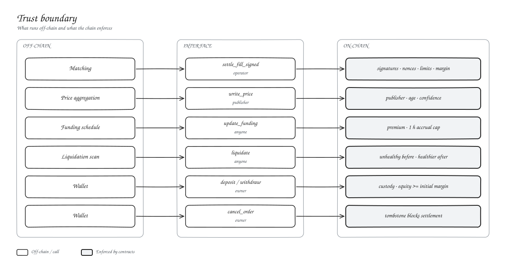

# Introduction

We built Kryon to give traders the feel of a centralised perps venue without handing over custody.

## How it works

Kryon is a hybrid exchange. The order book and matching run off-chain, where they can be fast. Settlement runs on-chain, where it can be trusted.

- **You sign orders, not trades.** An order signature binds the market, side, size, limit price, nonce and expiry. The matcher can fill it in pieces, but never beyond what you signed.
- **Every fill is a transaction.** The order gateway verifies both signatures on-chain and drives the engine and vault for each side.
- **Collateral never leaves the vault.** Withdrawals are checked against your live equity, including unrealised losses.
- **Prices are guarded.** Every fill must sit inside a band around a fresh oracle price.

## At a glance

| | |
| --- | --- |
| Network | Stellar, Soroban smart contracts |
| Settlement asset | USDC |
| Collateral | USDC, plus USDT0 at a 500 bps haircut |
| Markets | XLM, BTC, ETH, SOL, XRP, ADA, BNB and TRX perpetuals |
| Margin | Cross margin, up to 50x depending on market |
| Matching | Price-time priority, maker price, partial fills |
| Funding | Mark vs index premium, accrued hourly at most |
| Liquidation | Permissionless, account-health based |

## What the chain guarantees

The contracts enforce these whatever our servers do:

- No position changes without a valid signature from each side.
- No order fills past its size, after its expiry or after an on-chain cancel.
- No fill executes at a worse price than your limit or outside the oracle band.
- No trade or withdrawal leaves an account below initial margin.
- No liquidation runs against a healthy account or leaves it worse off.

Our services keep the venue running: they decide which orders match and when, publish prices, and run the keepers. They cannot move your funds.

## Next

- [System architecture](../02-architecture/system-architecture.md)
- [Contracts overview](../03-smart-contracts/overview.md)
- [Glossary](glossary.md)
