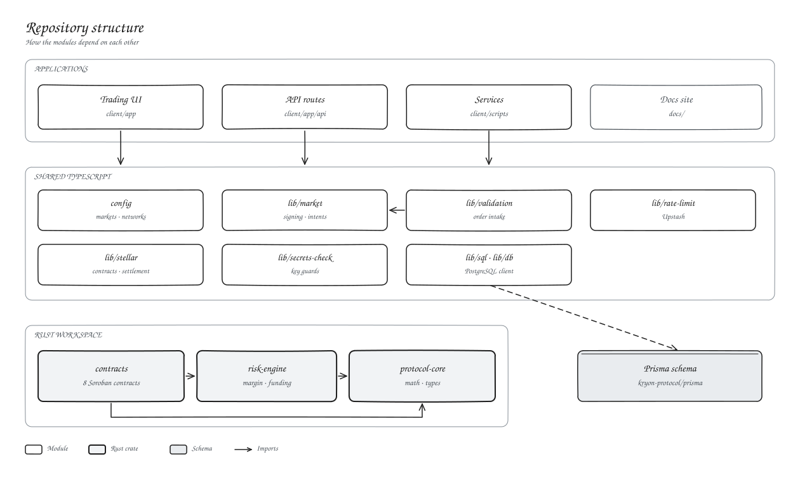

# Repository structure



```text
client/            Next.js app, API routes and services
  app/             pages and /api route handlers
  features/        trading terminal modules
  lib/             signing, Stellar, database, validation
  config/          markets, networks, precision
  scripts/         matcher, keepers, indexer, WebSocket, tools
kryon-protocol/    Rust workspace
  contracts/       eight Soroban contracts
  crates/          protocol-core, risk-engine
  prisma/          database schema and migrations
  infra/           deployment records and runbooks
docs/              this site and its diagrams
```

The two crates hold the math and the risk rules. The contracts are a thin storage and authorisation layer on top, so the rules can be tested without a chain.
