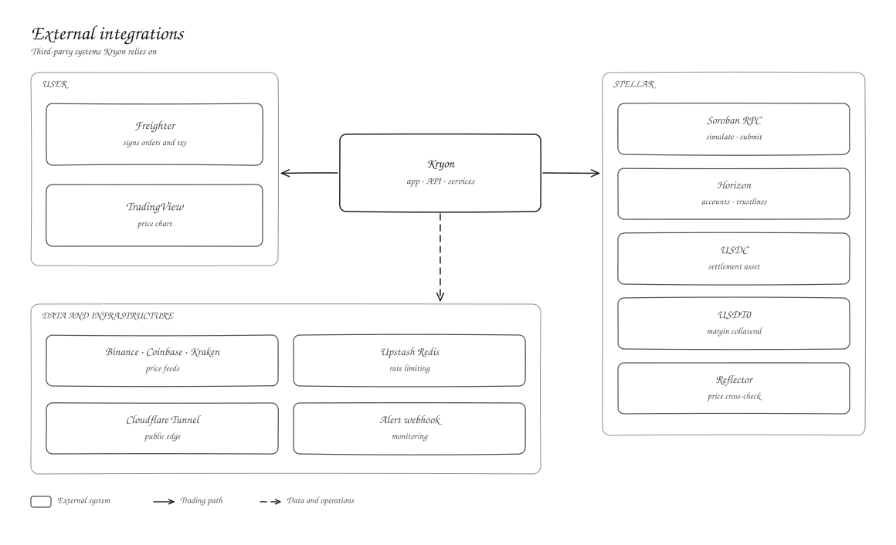

# External integrations

| System | Used for |
| --- | --- |
| Freighter | Signing orders (SEP-53) and transactions |
| Soroban RPC, Horizon | Every contract read and write, accounts and trustlines |
| USDC, USDT0 | Settlement asset and margin collateral |
| Binance, Coinbase, Kraken | Price sources for the oracle keeper |
| Reflector | Independent price cross-check |
| Upstash Redis | Shared rate limits across API instances |
| Cloudflare Tunnel | Public edge for the web tier |
| TradingView | Price chart |
| Alert webhook | Monitor alerts |

Price feeds and RPC responses are treated as untrusted. The keeper needs two agreeing sources, and the contracts re-check every price.
