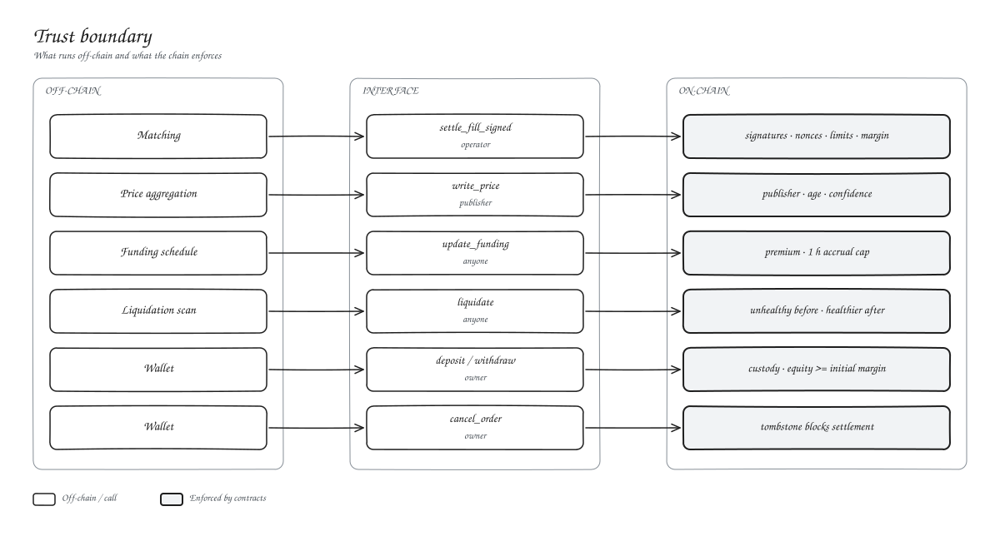

# Trust boundary

Everything off-chain can delay or reorder. Nothing off-chain can forge. Each path into the contracts has its own gate:

| Call | Who can call it | What the chain checks |
| --- | --- | --- |
| `settle_fill_signed` | Matcher operator | Both signatures, nonce, size, limit, expiry, cancel, self-trade, band, OI, margin |
| `write_price` | Oracle publisher | Publisher, age, confidence, newer than last |
| `update_funding` | Anyone | Fresh oracle, one-hour accrual cap |
| `liquidate` | Anyone but the account | Unhealthy before, healthier after, band |
| `deposit` / `withdraw` | Account owner | Listed asset, cap, equity after withdrawal |
| `cancel_order` | Account owner | Owner signature |

## What depends on us

- **Matching order.** The contracts check prices and limits, not queue position.
- **Uptime.** Matching, prices, funding and liquidations need our services running.
- **Price inputs.** The publisher can write any price inside the age and confidence guards.

## What a fill record means

The matcher writes a fill row before settlement and removes it if settlement fails. The on-chain proof that a fill settled is `gateway.filled(owner, nonce)` or the transaction itself.
