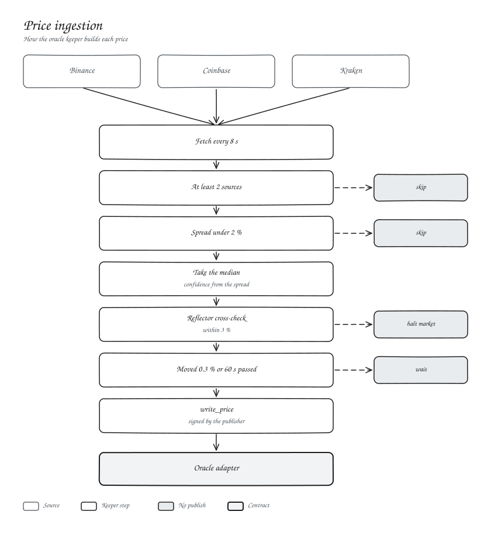
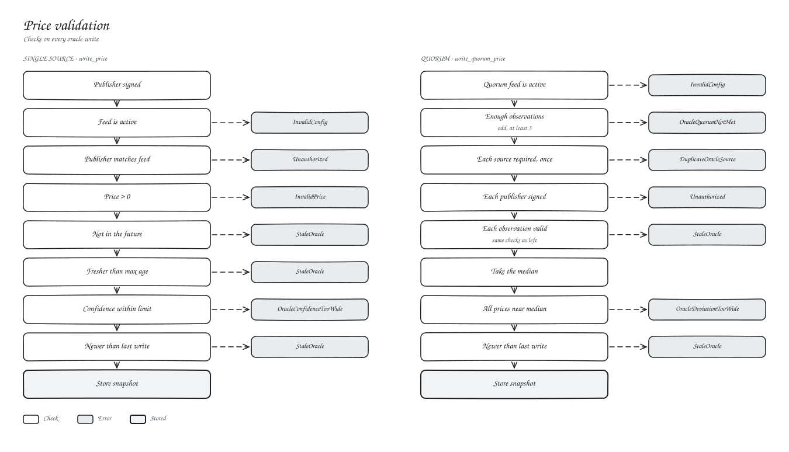
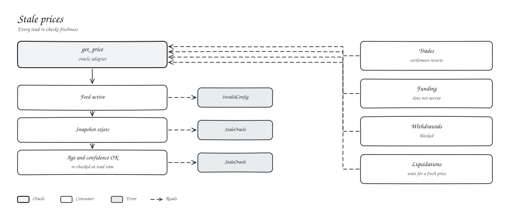
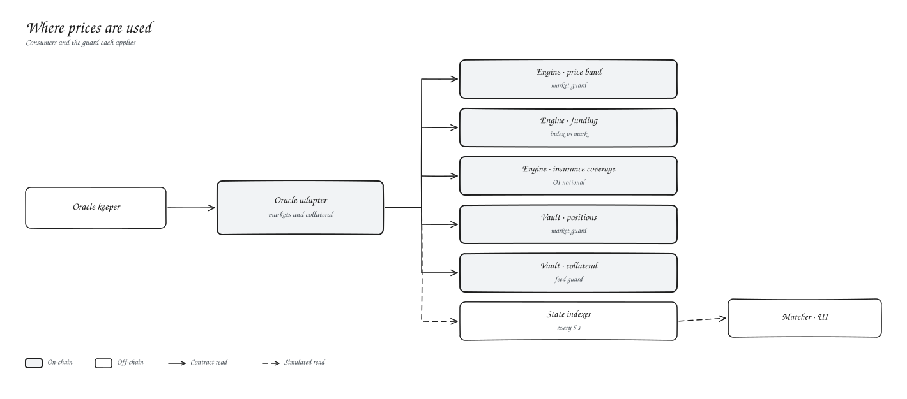

# Oracle

Every market and collateral asset has an on-chain feed in the oracle adapter. Our oracle keeper builds each price from three exchanges and publishes it.

## Ingestion

| Rule | Default |
| --- | --- |
| Fetch interval | 8 s |
| Minimum sources | 2 of Binance, Coinbase, Kraken |
| Maximum source spread | 200 bps, or the tick is skipped |
| Price | Median of the sources |
| Confidence | Half the spread, at least 0.1 % of price |
| Reflector cross-check | Halts the market above 300 bps divergence |
| Publish trigger | 30 bps move or 60 s heartbeat |

Stablecoins are priced too. USDC publication halts if it moves more than 100 bps off the peg, so a depeg fails closed rather than valuing collateral at $1.

## Validation

Writes must come from the feed's publisher, carry a positive price, sit within the feed's age and confidence limits, and be newer than the last write. Feeds can also run as a quorum: an odd number of independent publishers, combined by median, with a cap on how far any source may sit from it.

## Stale prices

There is no fallback price. Every read re-checks age and confidence, and anything that needs a price stops until a fresh one lands.

## Where prices are used

| Consumer | Guard |
| --- | --- |
| Engine price band | Market guard (120 s, 1000 bps confidence) |
| Engine funding | Market guard |
| Vault position valuation | Market guard |
| Vault collateral valuation | Feed guard (USDC: 600 s) |

## Related

- [Oracle adapter](../03-smart-contracts/oracle-adapter.md)
- [Funding](../04-trading-mechanics/funding.md)
