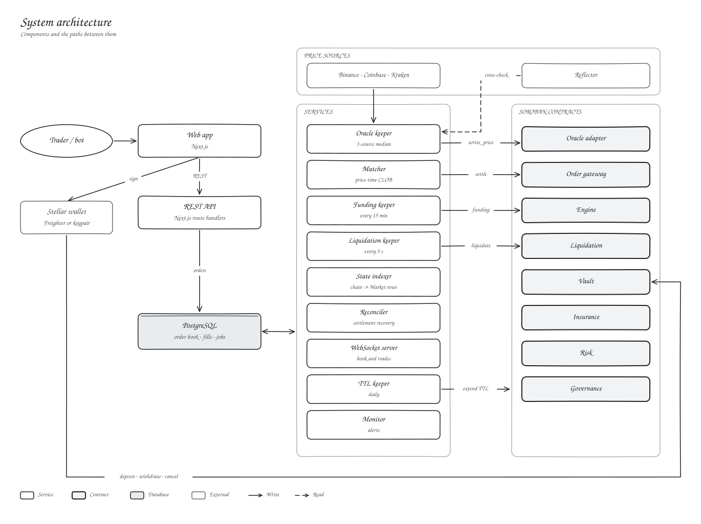

# System architecture

Kryon has four layers.

| Layer | What runs there | Job |
| --- | --- | --- |
| Client | Web app, Freighter or a bot key | Sign orders and transactions |
| API | Next.js route handlers | Accept orders, serve market data |
| Services | Matcher, keepers, indexer, WebSocket, monitor | Match, settle, price, liquidate, keep things live |
| Contracts | Eight Soroban contracts | Verify, account and custody |

PostgreSQL holds the order book, the fill log and settlement jobs. It is never the source of truth for balances or positions; the contracts are.

## One trade, end to end

1. You sign an order and post it to `POST /api/orders`.
2. The API checks the fields and the signature, then stores it.
3. The matcher finds a crossing order inside the oracle band and submits `settle_fill_signed`.
4. The gateway verifies both signatures and limits. The engine checks the band, open interest and margin, and the vault books the PnL.
5. The matcher marks the fill confirmed. If settlement fails, the fill is removed and both orders go back to the book.
6. The indexer picks up the new open interest and funding state.

## When something stops

| If this stops | You see |
| --- | --- |
| Matcher | No new fills. Your funds and positions are untouched. |
| Oracle keeper | Prices go stale after two minutes and trading pauses itself. |
| Database | Order entry stops. Deposits, withdrawals and on-chain cancels still work. |
| Liquidation keeper | Anyone can still call `liquidate`. |

## Related

- [Trust boundary](onchain-offchain-boundary.md)
- [Services](../05-infrastructure/backend-services.md)
