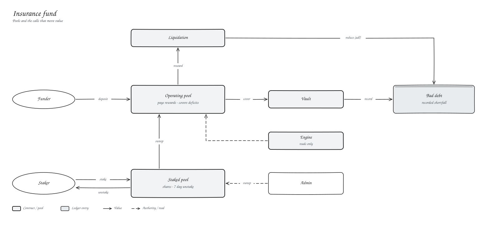

# Insurance

`perp-insurance` holds the backstop capital.

## Public functions

| Function | Caller | What it does |
| --- | --- | --- |
| `deposit(funder, asset, amount)` | anyone | Adds to the operating pool |
| `stake(staker, asset, amount)` | staker | Joins the staked pool for shares |
| `request_unstake(staker, asset, shares)` | staker | Starts the 7-day cooldown |
| `withdraw_unstaked(staker, asset)` | staker | Redeems at current value |
| `pay_liquidator(liquidator, asset, amount)` | liquidation | Pays the reward |
| `cover_deficit(asset, amount)` | vault | Sends tokens to the vault |
| `record_bad_debt(asset, amount)` | vault | Records a shortfall |
| `reduce_bad_debt(asset, amount)` | liquidation | Clears paid-down bad debt |
| `sweep_to_operating(asset, amount)` | admin | Moves staked capital to the operating pool |
| `balance_of`, `bad_debt_of`, `staked_balance_of`, `shares_of`, `total_shares_of`, `pending_unstake`, `share_price` | anyone | Views |
| `set_liquidation`, `set_vault` | admin | Wiring |
| `initialize(admin, liquidation)` | admin | |
| `upgrade`, `nominate_admin`, `accept_admin`, `admin`, `pending_admin` | admin / nominee | |

Shares are priced against the staked pool only. If a sweep takes it to zero, all shares retire, so whoever refills the pool is not diluted.
