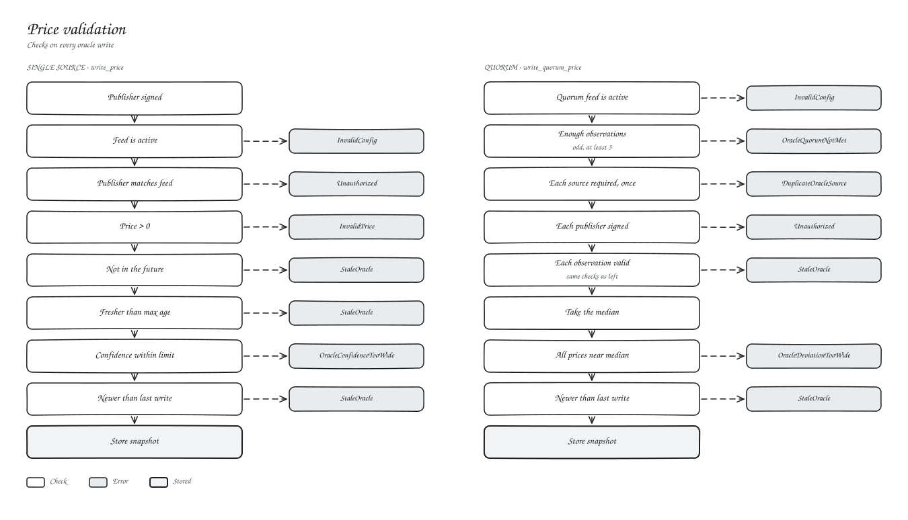

# Oracle adapter

`perp-oracle-adapter` stores one guarded price per asset and re-validates it on every read.

## Public functions

| Function | Caller | What it does |
| --- | --- | --- |
| `write_price(asset, publisher, price, confidence, publish_time)` | publisher | Single-source write |
| `write_quorum_price(asset, observations)` | each source publisher | Median of independent sources |
| `get_price(asset, override_guard)` | anyone | Validated read |
| `set_feed(asset, publisher, source, guard, active)` | admin | Single-source feed |
| `set_quorum_feed(asset, guard, required_sources, min_sources, max_source_deviation_bps, active)` | admin | Quorum feed, odd and at least 3 sources |
| `set_source_publisher(asset, source, publisher)` | admin | Publisher per quorum source |
| `extend_instance_ttl()` | anyone | |
| `initialize(admin)` | admin | |
| `upgrade`, `nominate_admin`, `accept_admin`, `admin`, `pending_admin` | admin / nominee | |

A guard is `{ max_age_secs, max_confidence_bps }`. Readers can pass a stricter guard; the engine and vault pass the market's.

## Related

- [Oracle](../02-architecture/oracle-architecture.md)
