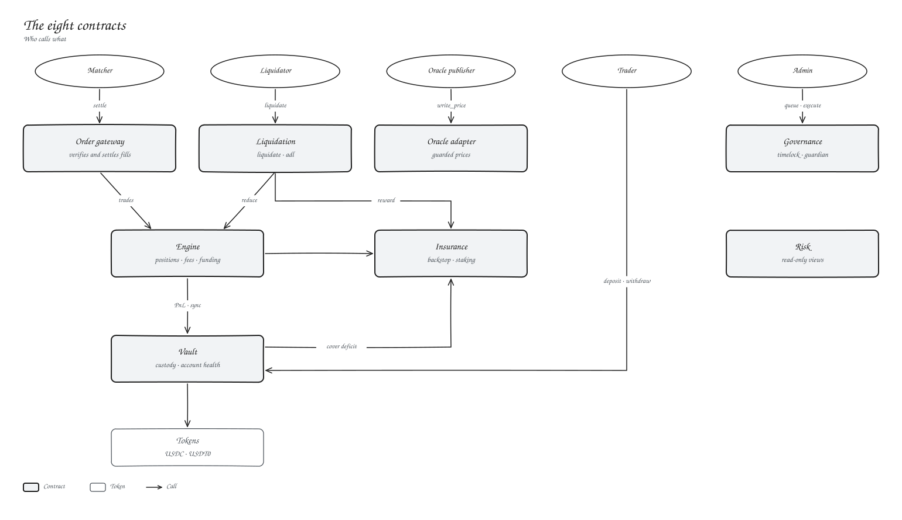
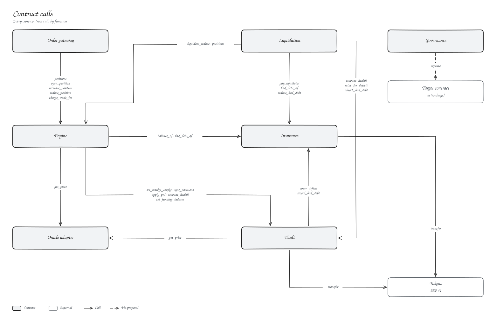
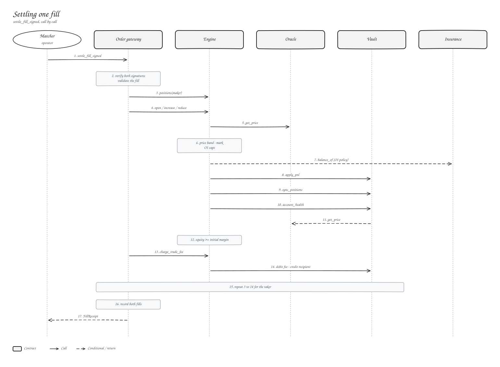
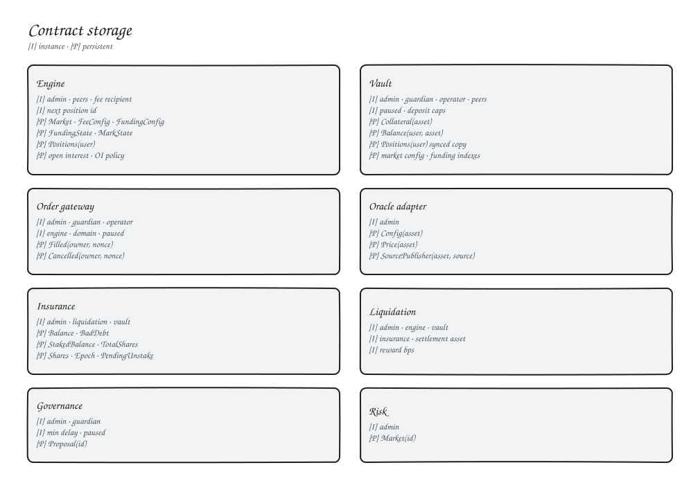

# Contracts overview

Kryon runs on eight Soroban contracts written in `#![no_std]` Rust against `soroban-sdk` 23. Each one has a single job.

| Contract | Job |
| --- | --- |
| [Order gateway](order-gateway.md) | Verifies signed orders and settles matched fills |
| [Engine](engine.md) | Positions, open interest, fees, funding, price band |
| [Vault](vault.md) | Custody, balances, account health, withdrawals |
| [Oracle adapter](oracle-adapter.md) | Guarded price feeds |
| [Liquidation](liquidation.md) | Liquidations and auto-deleveraging |
| [Insurance](insurance.md) | Backstop capital, staking, bad debt |
| [Risk](risk.md) | Read-only risk calculations |
| [Governance](governance.md) | Timelocked admin actions |

## How they fit

- **Only the gateway can trade.** Engine position calls require the gateway, and the gateway only calls them after checking both signatures.
- **Only the engine moves PnL.** The vault's `apply_pnl` and `sync_positions` require the engine.
- **Only liquidation can force a reduction.** It is also the only caller of seizure and bad-debt absorption.
- **The vault computes health from its own state.** The engine syncs each account's positions into the vault after every change, so nobody can hand the vault a made-up account.
- **Prices are read, never pushed.** The engine and vault read the oracle on every price-dependent call.

## Calls between contracts

Contract-to-contract authorisation uses Soroban invoker auth: when the gateway calls the engine, the engine's `require_auth` on the gateway passes because the gateway is the caller.

## Settling one fill

## Storage

Small config lives in instance storage. Positions, balances, feeds and fill records live in persistent storage. The TTL keeper extends every instance and its WASM, and gateway fill records are extended on write.

## Shared patterns

| Pattern | Behaviour |
| --- | --- |
| `initialize` | Runs once, needs the admin's signature |
| Admin transfer | `nominate_admin` then `accept_admin` by the nominee |
| `upgrade` | Swaps WASM in place, keeps storage and address |
| Errors | One shared [`CoreError`](error-codes.md) enum |

The workspace has 101 unit tests, run with `cargo test --workspace`.
