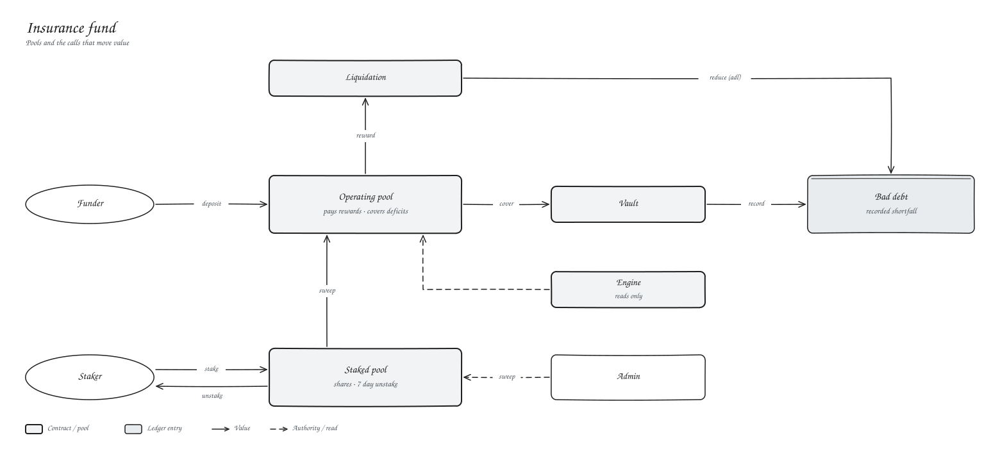

# Insurance fund

The insurance fund stands behind liquidations. When a position is closed with no one on the other side, the fund absorbs that exposure.

| Pool | Funded by | Pays for |
| --- | --- | --- |
| Operating | Deposits, sweeps from staking | Liquidator rewards, account deficits |
| Staked | Stakers | Swept into operating when needed |

## Staking

Stake to receive shares priced against the staked pool. To exit, request an unstake and withdraw after 7 days at the share price at that time.

## Open interest limits

The engine can cap each market's open interest as a multiple of the fund (`set_oi_policy`), with a shared ceiling across all markets so the same capital is not promised twice. `insurance_coverage_bps` shows current coverage.
