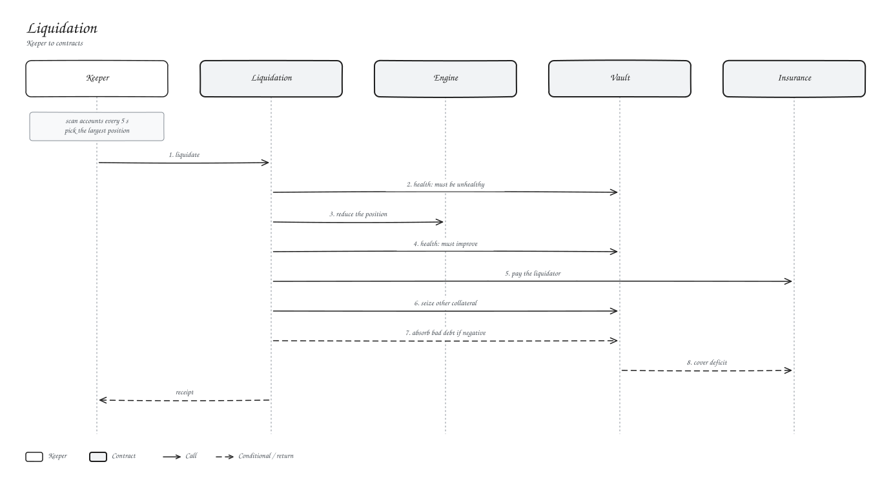

# Liquidation

An account can be liquidated when its equity drops below maintenance margin.

## Our keeper

Every 5 seconds the keeper checks accounts, picks the largest position of any unhealthy one, and tries the smallest close that should restore health first (the shortfall plus 25 %), then half, then all of it. It prices at the oracle.

Anyone else can call `liquidate` too.

## Who pays

| | |
| --- | --- |
| Liquidator reward | Paid by the insurance pool: closed notional x reward bps |
| Loss on the account | Settled from the account's collateral |
| Anything left over | Covered by insurance, then recorded as bad debt |

Recorded bad debt can be paid down with auto-deleveraging, which trims a profitable position on the other side.
