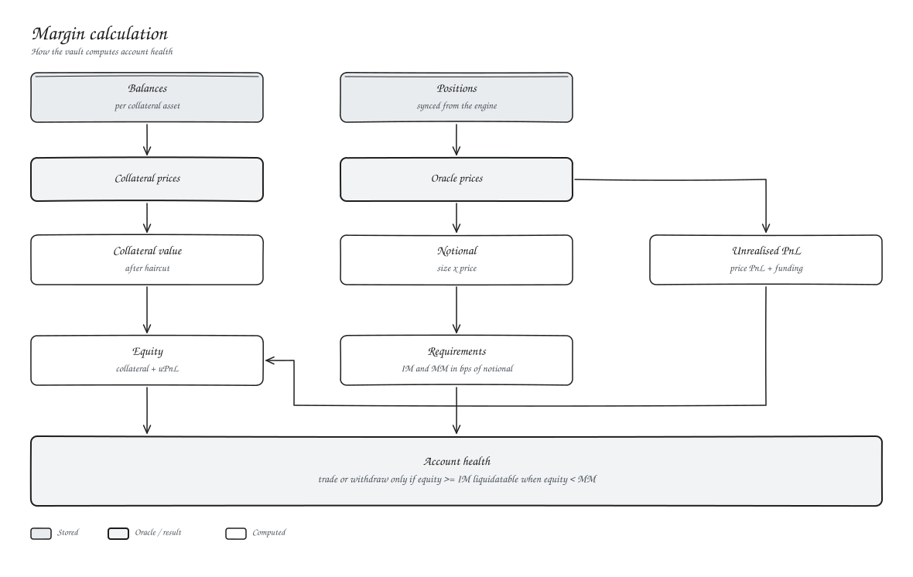

# Margin and leverage



```text
equity  = collateral value after haircuts + unrealised PnL
IM      = sum of notional x initial margin bps
MM      = sum of notional x maintenance margin bps
```

| Action | Allowed when |
| --- | --- |
| Open, increase, reduce, pay a fee | equity >= IM afterwards |
| Withdraw | equity minus the withdrawal >= IM |
| Get liquidated | equity < MM |

Leverage is set by initial margin: max leverage = 10,000 / initial margin bps.

| Market | IM | MM | Max leverage |
| --- | --- | --- | --- |
| XLM-PERP | 10 % | 5 % | 10x |
| BTC-PERP | 2 % | 1 % | 50x |
| ETH-PERP | 5 % | 2.5 % | 20x |
| SOL-PERP | 10 % | 5 % | 10x |
| XRP-PERP | 10 % | 5 % | 10x |
| ADA-PERP | 20 % | 10 % | 5x |
| BNB-PERP | 10 % | 5 % | 10x |
| TRX-PERP | 20 % | 10 % | 5x |

All margin is cross margin. Everything you hold backs everything you trade.

## Liquidation price

For a single position with collateral C:

```text
long:   (entry - C / size) / (1 - mm)
short:  (entry + C / size) / (1 + mm)
```

where `mm` is maintenance margin as a fraction.
