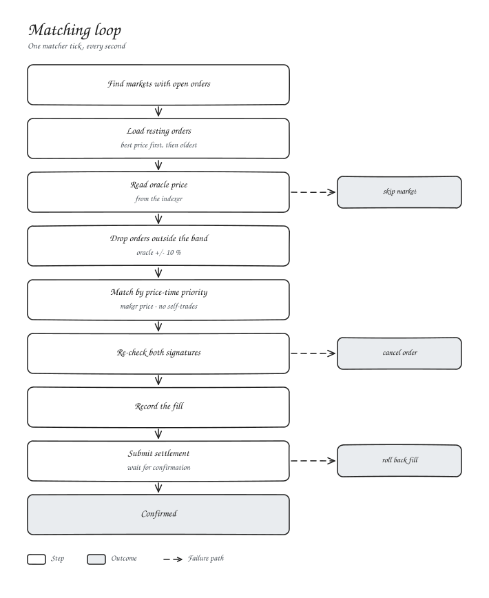
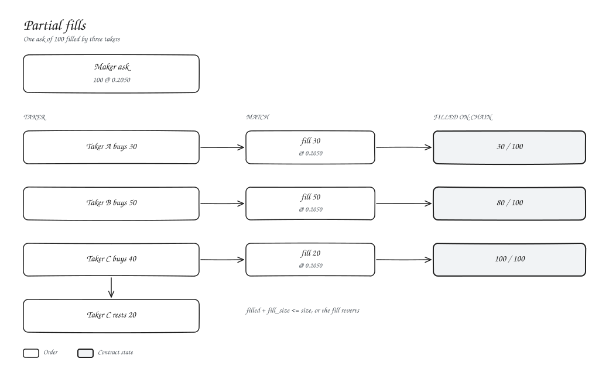

# Matching

| Rule | |
| --- | --- |
| Priority | Best price, then oldest |
| Maker | The older of the two orders |
| Fill price | The maker's limit |
| Fill size | The smaller remaining size |
| Self-trades | Skipped, and rejected on-chain |
| Band | Orders more than 10 % from the oracle wait until the price comes back |

The matcher runs once a second and settles each fill before moving to the next.

## Partial fills

An order can fill across any number of trades. The gateway keeps a running total per `(owner, nonce)` and rejects anything that would go past the signed size, so one signature safely covers every partial fill.
