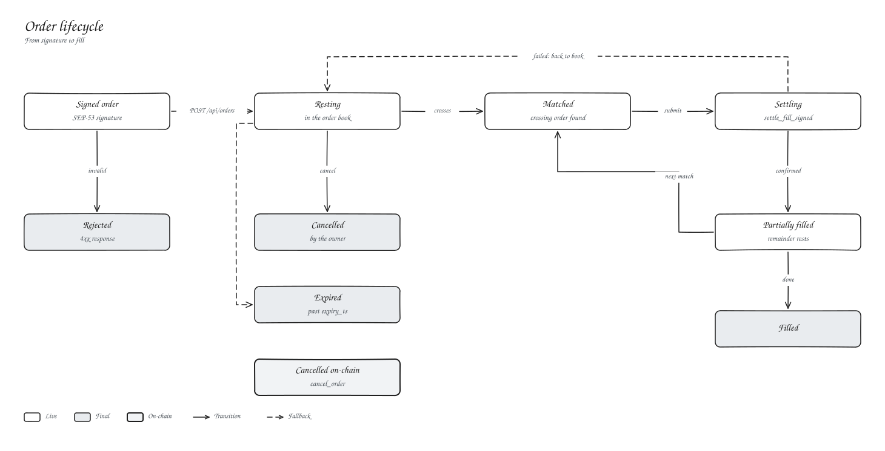
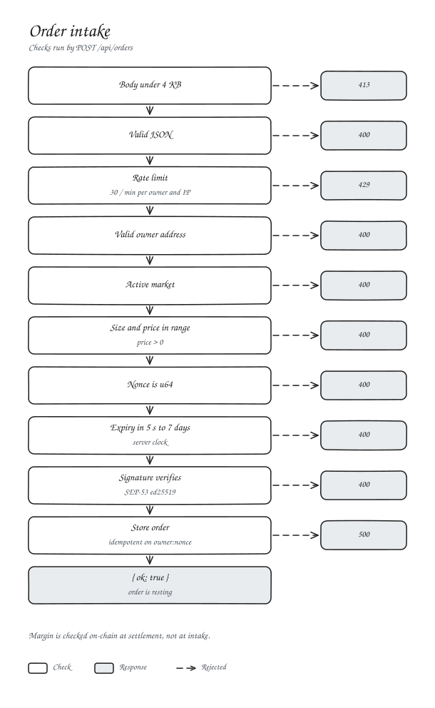

# Orders

## Order fields

| Field | Format |
| --- | --- |
| `owner` | Your `G...` address |
| `market_id` | Market number |
| `is_long` | `true` to buy, `false` to sell |
| `size` | Integer at 10^7 |
| `limit_price` | Integer at 10^18, above zero |
| `reduce_only` | Only shrink an existing position |
| `nonce` | u64, unique across all your orders |
| `expiry_ts` | Unix seconds, 5 s to 7 days ahead |
| `signature` | SEP-53 signature, base64 |

Every order is a limit order. To trade immediately, send an aggressive limit; the oracle band still caps the fill price.

## Intake

`{ ok: true }` means the order is in the book, not that it traded. Margin is checked on-chain when a fill settles.

## Cancelling

| How | Effect |
| --- | --- |
| `POST /api/orders/cancel` | Removes the order from the book |
| `POST /api/orders/cancel-all` | Removes all your orders, optionally in one market |
| `gateway.cancel_order` | On-chain tombstone. The contract refuses any further fill. |

Use the API for everyday cancels and `cancel_order` when you want the chain to enforce it.

## Nonces

Nonces identify orders on-chain, so keep them unique per account across every market. Reusing one means the second order is ignored. The web app uses `Date.now() x 1000 + counter`, always increasing.
