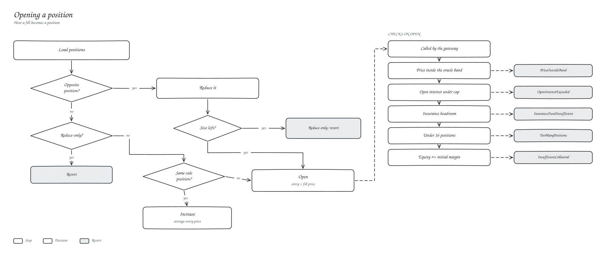
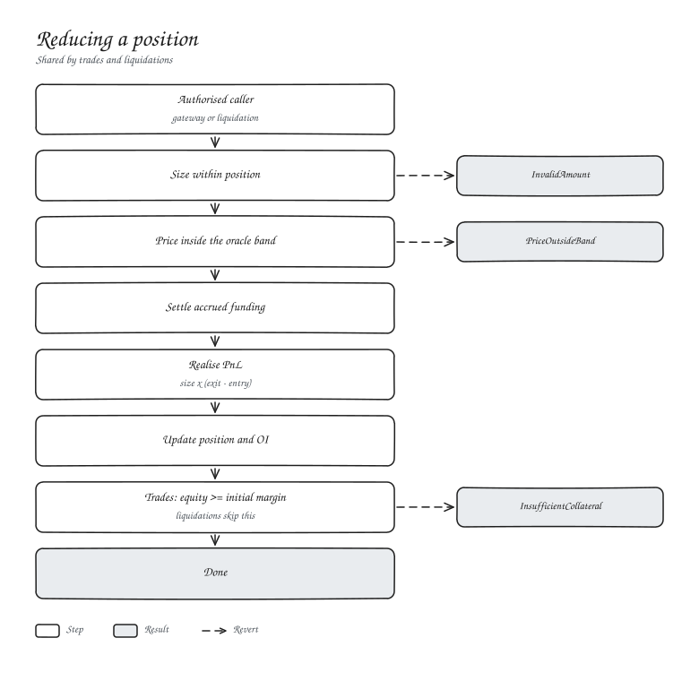

# Positions and PnL

You hold one position per market. A fill against it reduces, increases or flips it.





## Formulas

```text
increase:      entry = (old notional + new notional) / (old size + new size)
realised PnL:  size closed x (exit - entry)          long
               size closed x (entry - exit)          short
unrealised:    size x (oracle - entry) + accrued funding
```

Realised PnL, funding and fees settle into your USDC balance in the vault. Unrealised PnL uses the oracle price, not the last trade.

## Example

XLM-PERP, 10 % initial margin. Deposit 100 USDC and buy 1,000 XLM at 0.2000.

| Step | Result |
| --- | --- |
| Notional 200 USDC, margin needed 20 | trade goes through |
| Oracle moves to 0.2100 | unrealised +10, equity 110 |
| Sell 400 at 0.2100 | realised +4, 600 left at 0.2000 |
| Sell 1,000 at 0.2050 | closes 600 (+3), opens a 400 short at 0.2050 |
