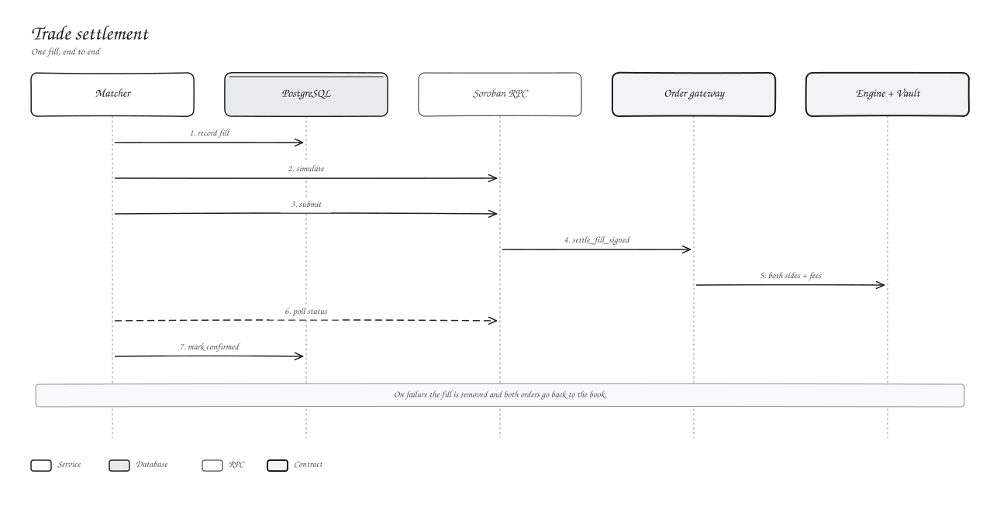

# Settlement

Every fill is its own Soroban transaction, submitted by the matcher and checked by the contracts.

## Steps

1. The matcher records the fill and simulates `settle_fill_signed`. Simulation runs every on-chain check.
2. It signs with the operator key and submits.
3. The gateway verifies both order signatures and limits, then for each side the engine updates the position, books PnL and checks margin, and the fee is charged.
4. The matcher waits for confirmation and marks the job confirmed.

If any check fails, the whole transaction reverts, the fill is removed and both orders go back to the book.

## What settles a trade

The chain is the record. `gateway.filled(owner, nonce)` tells you exactly how much of an order has settled, and `engine.positions(owner)` shows the result.

## Replay protection

| Where | How |
| --- | --- |
| Contract | Running fill total per order, on-chain cancels, 7-day expiry limit |
| Database | Unique keys on fills and jobs, guarded fill counters |
