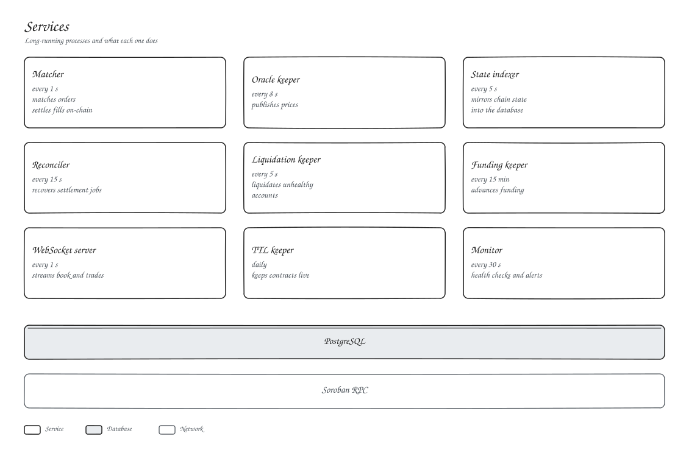

# Services

Our services are TypeScript processes in `client/scripts`, run under PM2. Each signing service has its own key, so they never fight over a sequence number.

| Service | Script | Cadence | Key |
| --- | --- | --- | --- |
| Matcher | `matcher-service.ts` | 1 s | `MATCHER_OPERATOR_SECRET` |
| Oracle keeper | `oracle-keeper.ts` | 8 s | `ORACLE_PUBLISHER_SECRET` |
| State indexer | `state-indexer.ts` | 5 s | none |
| Reconciler | `settlement-reconciler.ts` | 15 s | `MATCHER_OPERATOR_SECRET` |
| Liquidation keeper | `liquidation-keeper.ts` | 5 s | `LIQUIDATOR_SECRET` |
| Funding keeper | `funding-keeper.ts` | 15 min | `FUNDING_KEEPER_SECRET` |
| WebSocket server | `ws-server.ts` | 1 s | none |
| TTL keeper | `ttl-keeper.ts` | daily | `TTL_KEEPER_SECRET` |
| Monitor | `monitor.ts` | 30 s | none |

Each one has an npm script (`npm run dev:matcher`, `dev:oracle`, and so on). Services refuse to start if a required key is missing or if a secret is exposed through a `NEXT_PUBLIC_` variable.
