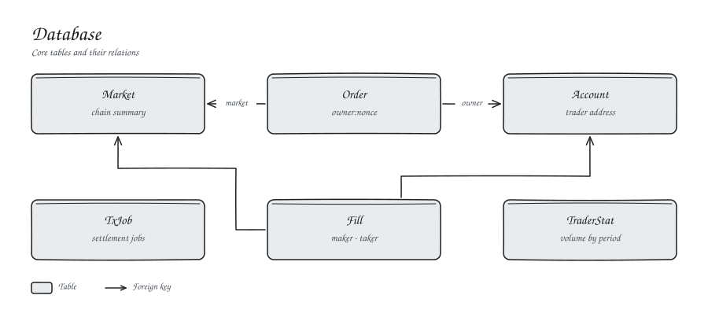

# Database



PostgreSQL holds the off-chain order book and the trading log. Schema: `kryon-protocol/prisma/schema.prisma`.

| Table | Holds |
| --- | --- |
| `Market` | Market summary mirrored from the chain |
| `Account` | Traders seen by the API |
| `Order` | Signed orders, keyed `owner:nonce` |
| `Fill` | Matched fills |
| `TxJob` | Settlement jobs and their status |
| `TraderStat` | Volume and trade counts by period |

Amounts are stored as integer strings at the same scales as the contracts.

```bash
cd kryon-protocol && npm run db:migrate:deploy
cd client && npm run db:seed-markets
```
