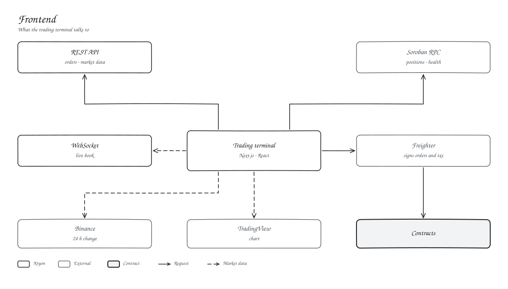

# Frontend

The trading terminal is a Next.js 16 and React 19 app in `client/`.

| Talks to | For |
| --- | --- |
| REST API | Orders, book, trades, candles |
| Soroban RPC | Positions, health, balances, straight from the contracts |
| Freighter | Order signatures and transactions |
| WebSocket | Live book and trades |
| TradingView, Binance | Chart and 24 h change |

| Route | Page |
| --- | --- |
| `/trade/[market]` | Trading terminal |
| `/markets` | Market list |
| `/portfolio` | Your account |
| `/docs` | This documentation |
