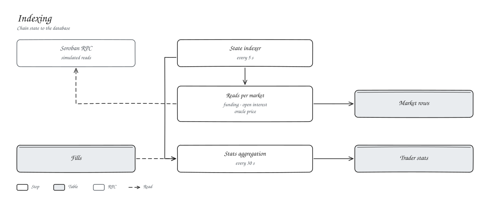

# Indexing

Every 5 seconds the state indexer reads each market's funding state, open interest and oracle price through RPC simulation and writes them to the `Market` table. Every 30 seconds it rolls fills up into per-trader volume and trade counts.

Account balances and positions are always read straight from the contracts, which is what the web app does.
