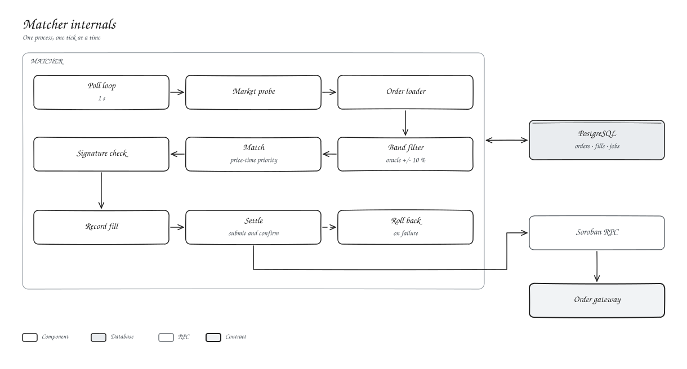

# Matcher

The matcher is a single process that runs one tick at a time. Each tick finds markets with open orders, drops anything outside the oracle band, matches by price-time priority, re-checks both signatures, records the fill and settles it. A failed settlement rolls the fill back so the orders can match again.

| Variable | Default |
| --- | --- |
| `MATCHER_INTERVAL_MS` | 1000 |
| `MATCHER_MAX_DEVIATION_BPS` | 1000 |
| `MATCHER_OPERATOR_SECRET` | required |

Run exactly one matcher per deployment.
