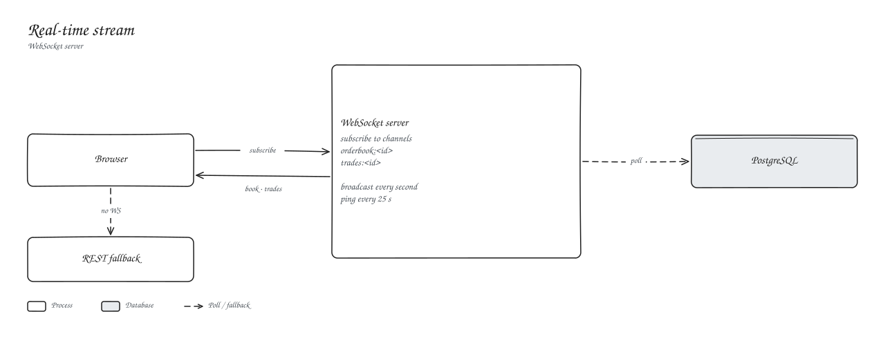

# Real-time stream

The WebSocket server pushes the order book and trades for each market once a second. The web app connects when `NEXT_PUBLIC_WS_URL` is set and falls back to REST polling otherwise. Message formats are in the [WebSocket API](../07-api-reference/websocket-api.md).
