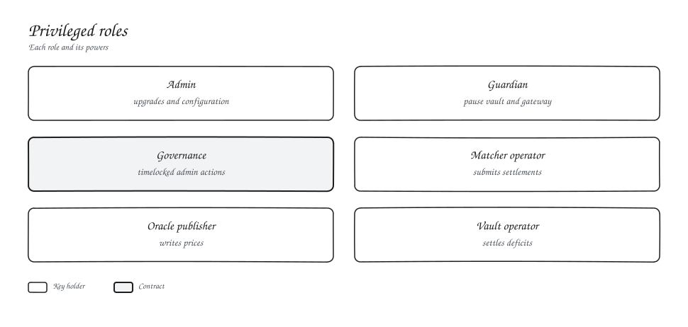
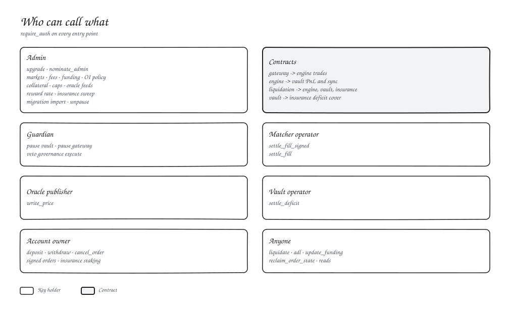

# Access control

| Role | Can | Cannot |
| --- | --- | --- |
| Admin | Upgrade, configure markets, fees, funding, collateral and feeds | Sign orders for users |
| Guardian | Pause the vault and gateway, veto governance | Unpause |
| Matcher operator | Submit settlements | Change any signed order |
| Oracle publisher | Write prices | Exceed the feed's age and confidence limits |
| Vault operator | Settle deficits | Move collateral out of the vault |

Admin rights move with `nominate_admin` and `accept_admin`, so a typo'd address can never take control. Role addresses are listed on [Deployments](../03-smart-contracts/deployments.md).
