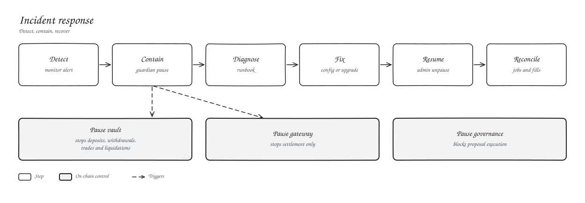

# Emergency controls

| Control | Stops |
| --- | --- |
| `vault.emergency_pause` | Deposits, withdrawals, trades, liquidations |
| `gateway.emergency_pause` | Settlement only |
| `governance.emergency_pause(true)` | Proposal execution |
| Stop the matcher | New fills |

The guardian or admin can pause; only the admin can unpause. Pause the gateway first if you only need to stop trading, since pausing the vault also stops liquidations.

## Recovery

1. Pause what is at risk.
2. Follow the matching [runbook](../09-operations/runbooks.md).
3. Fix with a config change or `upgrade`.
4. Unpause, then restart the oracle keeper, indexer and matcher in that order.
5. Reconcile settlement jobs against the chain.
