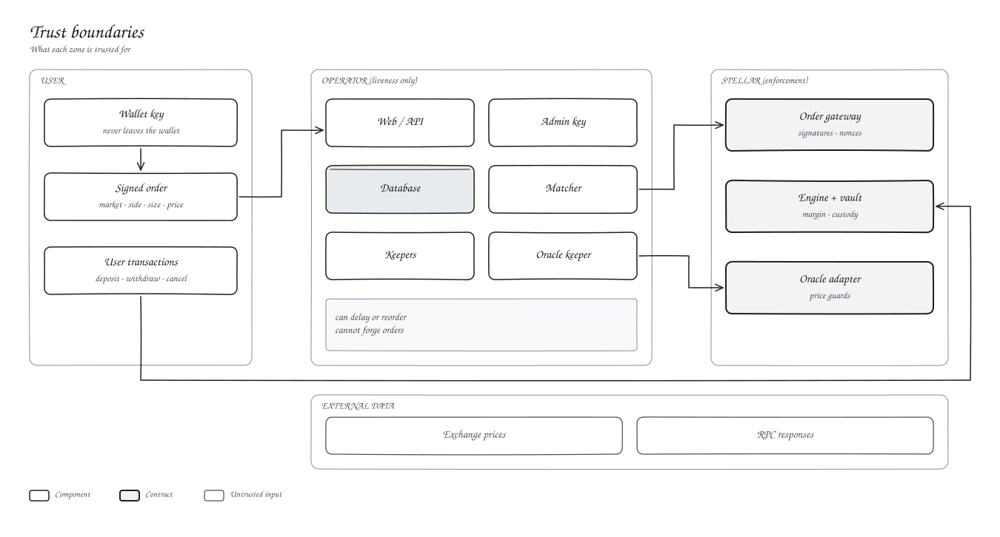
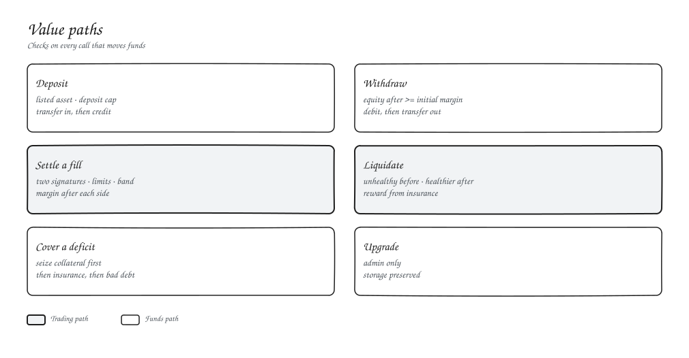

# Security model

We designed Kryon so that the off-chain side can only affect liveness and ordering, never balances.

## Threats we design for

| Threat | Defence |
| --- | --- |
| Forged or altered orders | Signatures verified on-chain over every order field |
| Replayed fills | Running fill total per order |
| Cross-network replay | Network passphrase inside every signed message |
| Settling a cancelled order | On-chain tombstones |
| Bad fill prices | Limit checks plus the oracle band |
| Under-margined withdrawals | Equity check from vault-held state |
| Hidden losing positions | Health computed from engine-synced positions only |
| Stale or wrong prices | Multi-source keeper, age and confidence checks on every read |
| Funding manipulation | Time-weighted mark, hourly accrual cap |
| Unfair liquidation | Must be unhealthy before and healthier after |
| Losses beyond collateral | Seizure, then insurance, then bad debt, then ADL |
| Overflow and rounding | Checked math, 256-bit products, rounding toward zero |
| API abuse | Body limits, rate limits before signature checks |

## What you trust us for

Matching order, uptime and price inputs within the guards. The contracts handle everything else.
