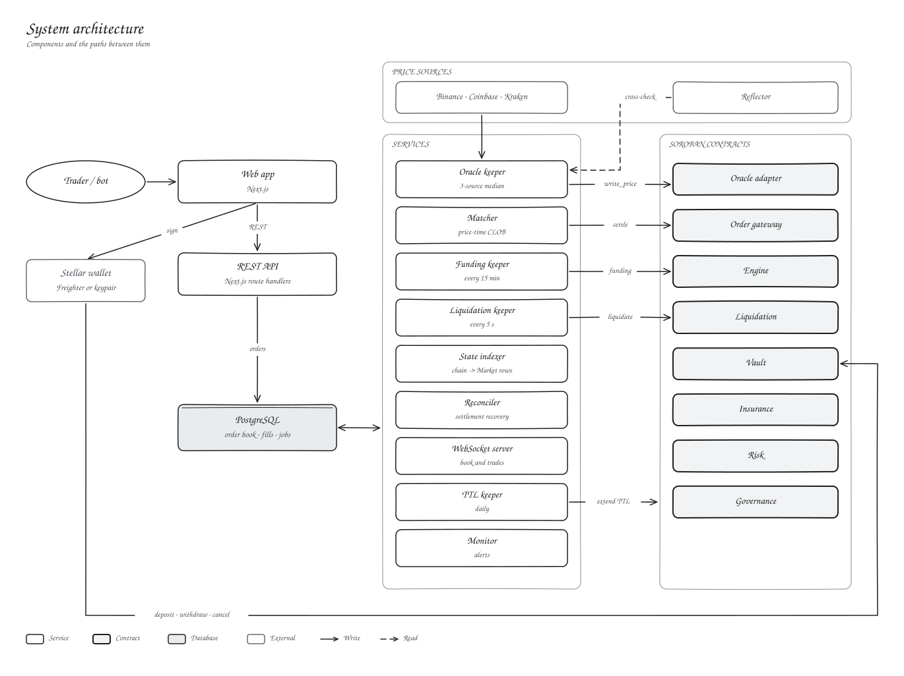

# Kryon Protocol

Kryon is a perpetual futures exchange on Stellar. We match orders off-chain for speed and settle every fill on-chain, so your collateral, margin and positions live in Soroban contracts that check every trade.

## Start here

| I want to | Read |
| --- | --- |
| Understand Kryon | [Introduction](01-overview/introduction.md) |
| See how it fits together | [System architecture](02-architecture/system-architecture.md) |
| Read the contracts | [Contracts overview](03-smart-contracts/overview.md) |
| Learn how a trade works | [Order lifecycle](04-trading-mechanics/order-lifecycle.md) |
| Build a bot | [Trading bots](06-developer-guides/trading-bot-guide.md) |
| Call the API | [REST API](07-api-reference/rest-api.md) |
| Review security | [Security model](08-security/threat-model.md) |
| Run Kryon | [Deployment](09-operations/deployment.md) |

## The short version

1. You sign an order with your Stellar key. That one signature covers every fill of the order.
2. Our matcher pairs orders by price and time.
3. The order gateway contract checks both signatures, the limits and the expiry, then the engine checks price, open interest and margin before anything moves.
4. Collateral stays in the vault contract the whole time.
